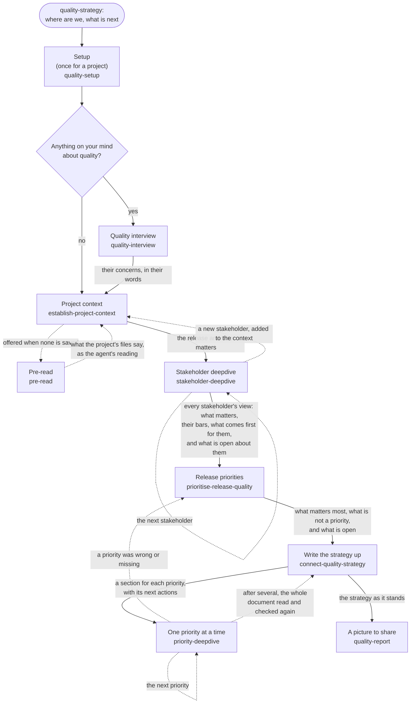

# Quality strategy

Quality is value to someone who matters. The approach to quality strategy in this pack derives from
the Context Driven Testing school: start by describing who matters, describe what matters to them,
then prioritise the work to achieve it. The approach is not dogmatic - coverage, checklists,
standards and established practice can all be part of the strategy, sometimes they are the exact
right thing for some stakeholder or some quality dimension. The key thing is the overall approach -
based on context, and understanding what this project needs to achieve.

Given infinite time and resources, you can always do more work to make a project better quality.
But nobody has infinite time and resources. The key output of a quality strategy is therefore
prioritisation. Not just what work to do, but in what order, and when to stop.

This skill pack approaches creating that strategy by first doing a deep dive on each stakeholder, to
understand what matters to them about quality in this context, then reconciling priorities across
all stakeholders. It operates at the scope of "a release" - a named delivery or milestone with a
purpose and scope. This helps create clarity when it comes to prioritisation, particularly for work
not in scope.

When the full process is done, the user will understand their release's priorities and risks: what
matters most and to whom, how good it must be, and where a gap or an unknown puts something in
danger. They will have an accurate picture of what is known and what is not, in which a
well-described open question is as much a result as an answer. The problems are named separately
from their solutions, because naming problems and finding solutions are different work and both
matter.
Together these answer the four key questions:

1. What does good look like?
2. How do we know if what we have is good?
3. How good is it now?
4. What do we do about it?

These four questions run across all the steps, rather than one step answering each in turn. Every
step adds to their answers, and a question is asked again whenever understanding changes.

The strategy is written up straight after the priorities, with a section for each priority, and is
true and usable at any point after that: what is known is filled in, and what is not is a question
with its next action. Each priority can then be worked further, one at a time.

The overall process is fairly involved and may need to be done in multiple sessions. The process
comprises a number of steps that must be taken in order, in order to achieve the
clarity of strategic thinking that we want to enable for the user. Based on the author's experience
in testing these skills, running multiple steps together encourages the agent executing the skills
to cut corners or mix different steps together, which creates a less useful strategy. Therefore,
this pack wraps each step of this quality strategy process into a separate skill, to be executed in
sequence.

On a simple project, several steps may fit into one session. On a more involved project, it may be
best to start a new session for each step.

Depending on the unknowns surfaced, work may be required to be undertaken in between sessions not
prescribed by this skill pack (at the discretion of the user and their agents).

**Goal.** The agent's role in this session is to tell the user where their strategy stands and
which step comes next, so that each step gets full attention.

**Done when.** The user understands what the quality strategy is, where they currently are in the
process, what comes next, and how to begin the next step.

## Tips for keeping this conversation on track

- It is their strategy. The agent's job is to say where things stand and recommend the next step.
  What the user actually does is up to them.
- Stick to one question per turn, to avoid confusion when the user answers.
- Talk about the user's project, rather than the internal process you are following.
- Say accurately what happened. Don't report anything as checked, reviewed or agreed unless it
  actually was.

## The map of quality strategy steps

Each step is a skill of its own, with its own instructions. The flowchart below describes the flow
through the skill steps. The steps come in this order because each
one works from what the one before it saved; the arrows show what that is. The dotted arrows that
point back show steps run again when a later step changes an earlier answer, such as a priority
found to be wrong. Going back is usual, not a failure of the order.

A script keeps track of where a strategy stands, so that nobody has to work it out from the
documents: each step is recorded in it as it happens, and `status` says which steps are done and
which comes next, so every session tells the user the same thing. The procedure in "What to do now"
follows what `status` says.

## If the user asks for a particular step

Name its command for them, written as [the harness page](../../references/harness.md) says.

If they ask to skip ahead to a later step, leaving the ones between for the agent to draft, they
may: open `draft-strategy-steps` and follow it. It asks them about the project context itself, so do
not ask here as well. When it is finished, name the step they asked for.

## What to do now

In this first turn you have to read the records before you can tell the user anything, so start
the turn with one sentence saying what they will get and roughly when, as [each
turn](../../references/each-turn.md) says. Do the same in a turn that opens a step
from here, because you read the step's own instructions only after the turn's first line.

Open [what to do now](references/what-to-do-now.md) and follow it every time, because it finds
where the strategy stands and says what to tell the user.
